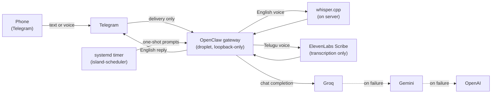

# Self-Hosted Assistant

A self-hosted personal AI assistant that I run on a small cloud server and talk to from my phone over Telegram, by text or voice. It checks in on a schedule (daily planning, weekly reflection, monthly reviews), remembers only what I explicitly ask it to, and keeps working when a model provider goes down.

This repository holds the operational code: the scheduler, model-routing and speech-to-text scripts, and architecture definitions. Secrets, host addresses and runtime state are deliberately not included.

## Architecture



| Layer | Choice |
| --- | --- |
| Host | DigitalOcean droplet, Ubuntu 24.04 LTS, 2 GB RAM / 1 vCPU |
| Agent runtime | [OpenClaw](https://docs.openclaw.ai) gateway as a systemd service under a dedicated non-sudo user |
| Channel | Telegram bot, owner-only allowlist, groups disabled |
| Models | Groq (OpenAI-compatible API) primary, Gemini then OpenAI as fallbacks |
| Speech-to-text | whisper.cpp on the server for English; ElevenLabs Scribe v2 for Telugu |
| Memory | Full-text search retrieval; saved only on explicit request; 14-day session maintenance |
| Scheduling | Owner-owned systemd timer that fires each workflow once per window |

## Security posture

- SSH only over Tailscale; public port 22 closed. Root SSH rejected.
- UFW default-deny inbound.
- Gateway bound to loopback with authentication; never exposed publicly. Tailscale Funnel/Serve off.
- Agent runs as an unprivileged user with a plugin allowlist; no shell or host commands from chat.
- Scheduler gets a narrow sudoers rule covering only its own systemd units (`scheduler/sudoers.d`).
- Secrets live in permission-restricted env files on the host, never in git, chat or shell history.
- Encrypted backups with a tested restore; the whole stack passes a full-reboot acceptance test.
- OpenClaw deep security audit: zero critical findings.

## Problems solved along the way

**Telugu transcribed as Tamil.** Voice notes mix English and Telugu. Forcing English wrecked Telugu; whisper's auto-detect (no `--language-candidates` in this build) kept choosing Tamil. A two-pass approach (detect, then transcribe or translate) worked on short notes, but on a 1-vCPU host the base model runs about 2.7x realtime, so notes longer than about 20 seconds blew the 120-second timeout. Final design: English stays on the server with whisper.cpp; anything detected as an Indic language is routed to ElevenLabs Scribe v2 for transcription only. See `scripts/diagnose-telugu-stt.sh`, `telugu-route-stt.sh`, `setup-elevenlabs-routing.sh`.

**One provider's quota took the whole bot offline.** The original setup had a single model provider and no fallback (`next=none` in the logs), so a usage limit silenced replies and scheduled prompts. Adding a provider means three coordinated changes: the plugin allowlist, the model policy, and secure key storage. See `scripts/setup-model-providers.sh` and `add-gemini-provider.sh`.

**Gateway crash loop when adding Groq.** Referencing `groq/*` made the gateway try to npm-install a provider plugin at startup; the service's read-only home protections made that fail (`EROFS`), and systemd restarted it 30 times. Fixed by calling Groq through its OpenAI-compatible endpoint as a custom provider, so no plugin install is needed (`scripts/apply-groqapi-bypass.sh`). Diagnosis of the underlying npm `EACCES` fault is in `scripts/fix-npm-launcher.sh`.

**Scheduled prompt failed on first run.** The scheduler runs as the admin user but OpenClaw runs as `openclaw`, which cannot read the admin home directory. `run-workflow.sh` now copies each prompt to `/tmp` with readable permissions before handing it over.

## Scheduled workflows

`scheduler/run-workflow.sh` runs from a 15-minute systemd timer and fires each workflow at most once per window, using lock files. It never retries a missed window, and silence is never treated as a reason to ask again.

| Workflow | When |
| --- | --- |
| Daily planning | Weekdays 08:00 |
| Weekly reflection | Sundays 22:00 |
| Career development review | 1st of the month, 10:00 |
| Personal project review | 1st of the month, 10:15 |

Prompts are in `scheduler/prompts/`; each one is one-shot, saves nothing unless asked, and keeps work details generic. Set `TZ_NAME` in `scheduler.env` (see `scheduler.env.example`).

## Local and offline models

`scripts/LOCAL-OLLAMA.md` covers a fully offline coding assistant on the PC (Ollama with a custom qwen2.5-coder 7B Modelfile plus a 1.5B autocomplete model, via the Continue extension), including why thinking models return blank replies on Ollama's OpenAI-compatible endpoint. `scripts/setup-ollama-offline.md` sketches an optional path for the droplet to use the PC's Ollama over Tailscale.

## Repository layout

```
architecture/   Architecture and message-sequence definitions (JSON)
scheduler/      Timer, service, sudoers rule, run-workflow.sh, prompts
scripts/        Model routing, fallback notices, speech-to-text, agent context, local Ollama
```

Scripts are written for this host's layout (`/home/openclaw/.openclaw`, admin user `admin`) and are meant to be read and adapted, not run blind. Host addresses appear as placeholders such as `DROPLET_TAILSCALE_IP`.
